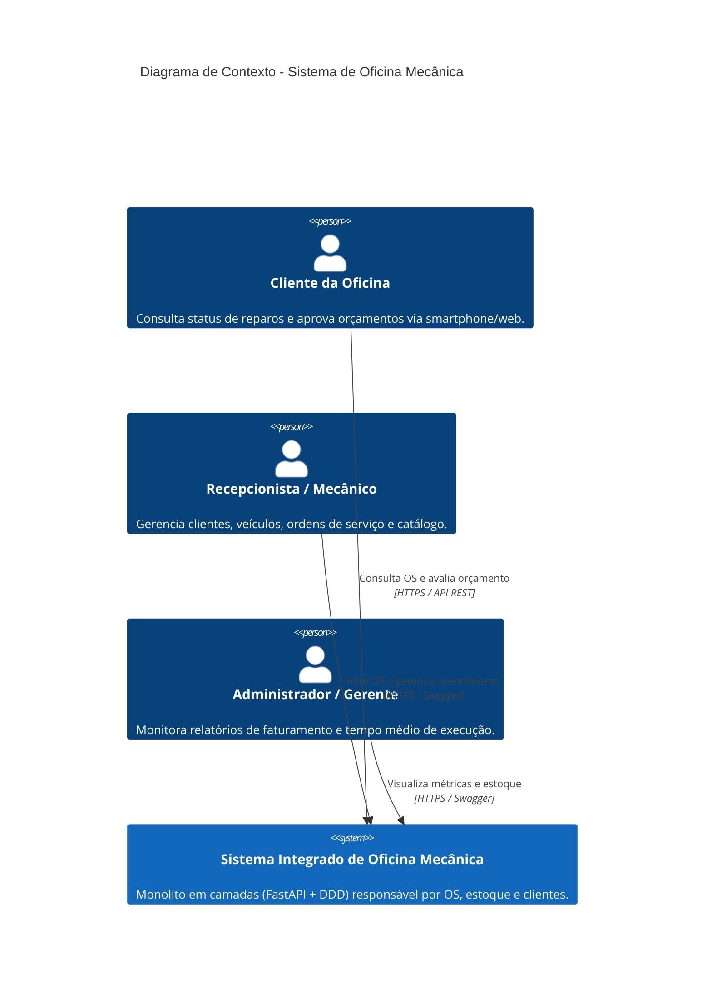

# Modelagem C4 (Níveis 1, 2 e 3)
Abaixo estão representados os diagramas C4 que detalham a arquitetura do Sistema Integrado da Oficina Mecânica.

## Nível 1: Diagrama de Contexto do Sistema
Descreve a interação entre os usuários e o sistema monolítico.

### Nível 2: Diagrama de Contêineres
Detalha os blocos de tecnologia que compõem a solução.
containerDiagram
    title Diagrama de Contêineres - Arquitetura do Monolito

    Person(usuario, "Usuários (Cliente e Staff)", "Acessam via Navegador ou App Cliente")

    Container(api, "API Back-End (Monolito)", "Python, FastAPI, Uvicorn", "Fornece APIs RESTful, autenticação JWT, regras de negócio em DDD e documentação Swagger.")
    ContainerDb(db, "Banco de Dados Relacional", "PostgreSQL / SQLite", "Armazena Clientes, Veículos, Serviços, Peças/Estoque e Ordens de Serviço com consistência ACID.")

    Rel(usuario, api, "Faz requisições HTTP", "JSON / HTTPS")
    Rel(api, db, "Lê e grava dados transacionais", "SQLAlchemy ORM")

#### Nível 3: Diagrama de Componentes (Dentro do Contêiner API)
Detalha a organização interna em camadas da aplicação (Arquitetura em Camadas + DDD).

componentDiagram
    title Diagrama de Componentes - Camadas da Aplicação

    package "Apresentação (Presentation)" {
        component [Controllers / Endpoints REST] as endpoints
        component [Schemas Pydantic & Auth JWT] as schemas
    }

    package "Aplicação (Application)" {
        component [Casos de Uso (Use Cases)] as usecases
    }

    package "Domínio (Domain - DDD)" {
        component [Entidades & Agregados (OS, Cliente, Peça)] as entities
        component [Objetos de Valor (CPF/CNPJ, Placa, Status)] as valueobjects
        component [Interfaces de Repositório (Portas)] as ports
    }

    package "Infraestrutura (Infrastructure)" {
        component [Modelos ORM (SQLAlchemy)] as models
        component [Repositórios Concretos] as repos
        component [Sessão e Conexão DB] as session
    }

    endpoints --> usecases : Aciona fluxos
    usecases --> entities : Executa regras de negócio
    entities --> valueobjects : Valida dados
    usecases --> ports : Utiliza contratos
    repos --|> ports : Implementa
    repos --> models : Mapeia ORM
    models --> session : Persiste dados

